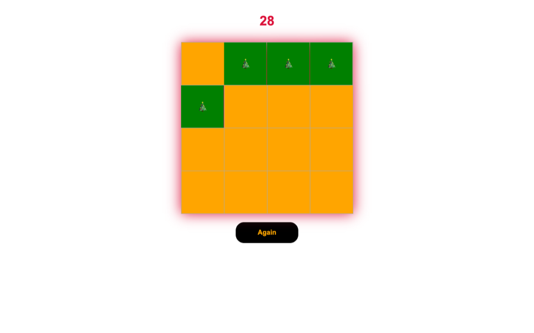

# Find the Christmas Tree

A game of luck and speed: open cells to find Christmas trees without hitting a bomb.

**[Play online →](https://ceyhun1999.github.io/GAME-Find-Christmas_Tree/)**

<p align="center"></p>

## How to play

- The 4×4 board hides Christmas trees 🎄 and three bombs 💣
- Click cells: a tree turns the cell green, a bomb ends the game
- You have 29 seconds; the **Again** button starts a new round

## Project structure

```
├── index.html
├── css/
└── javascript.js   # timer, random layout, opening cells
```

## Run locally

No build step. Open `index.html` in a browser, or start a local server:

```bash
python3 -m http.server 8000
```

Then go to http://localhost:8000.

## Tech stack

HTML · CSS · JavaScript (no libraries)
